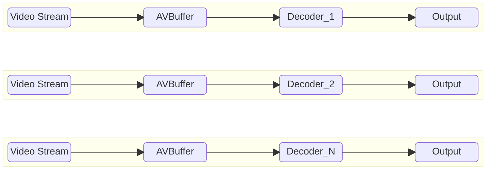

# VideoDecoder High Level Test Specification Document

## Table of Contents

- [Acronyms, Terms and Abbreviations](#acronyms-terms-and-abbreviations)
- [Introduction](#introduction)
- [Module Description](#module-description)
- [Test Stream specifications](#test-stream-specifications)
- [L2 Test Specification](#l2-test-specification)
- [L3 Test Specification](#l3-test-specification)

## Acronyms, Terms and Abbreviations

- `HAL`    - Hardware Abstraction Layer
- `API`    - Application Programming Interface
- `AIDL`   - Android Interface Definition Language
- `Caller` - Any user of the interface via the APIs
- `NA`     - Not Applicable
- `L2`     - Level 2 Testing
- `L3`     - Level 3 Testing
- `CB`     - Call-back function (suffix)
- `HDR`    - High Dynamic Range
- `SDR`    - Standard Dynamic Range
- `HEVC`   - High Efficiency Video Coding
- `RDK`    - Reference Design Kit
- `EOS`    - End of Stream
- `CSD`    - Codec Specific Data
- `NA`     - Not Applicable
- `Y`      - Yes

## Introduction

This document provides an overview of the testing requirements for the Video Decoder module. It outlines the scope of testing, objectives, testing levels and approaches, specific test requirements.

- `HAL` Interface Header [Interface Header](https://github.com/rdkcentral/rdk-halif-aidl/tree/0.23.0/videodecoder/0.3.0.0/com/rdk/hal/videodecoder)
- `HAL` specification documentation in this link - [Video Decoder HAL Specification info](https://rdkcentral.github.io/rdk-halif-aidl/halif/video_decoder/current/video_decoder/)

## Module Description

The Video Decoder `HAL` service provides the interfaces for compressed video to be passed to the vendor layer for decoding.  It may be passed secure buffers if it indicates support for secure video processing.

The output of an video decoder can take two routes:

1. **Non-tunnel mode** - Decoded video frames with metadata are sent back to the `RDK` media pipeline.
2. **Tunnel mode** - Video is passed directly to the vendor layer mixer.

## Test Stream specifications

- List of video test streams: [Video TestStreams](VideoDecoder_TestStreamsInfo.md)

- Each Test should refer [vts_l3_test_config.yaml](../../videodecoder_test_configuration/vts_l3_VideoDecoder_test_config.yaml) for the streams and information like `PTS`, frame sizes for the test.

### L2 Test Specification

|#|Test |Description|HAL APIs|
|-|-----|-----------|--------|
|1|Set and Get video Decoder Properties| - Get Supported Video Decoders `IVideoDecoderManager` class by calling `getVideoDecoderIds()`.   - Verify that the returned array of `IVideoDecoder.Id` objects is not null and contains valid IDs.   - Loop through each supported video decoder ID.   - Get Video Decoder Interface using `getVideoDecoder(videoDecoderId)`.   - Verify that the returned `IVideoDecoder` object is not null.   - Set and Verify Read-Write Properties:   &emsp; - For each read-write property in the `Property` enum   &emsp; - Set the property using `setProperty(property, propertyValue)`.   &emsp; - Retrieve the property value using `getProperty(property)`.   &emsp; - Verify that the retrieved value matches the set value.  &emsp; - Close the decoder using `close()`.    | - `IVideoDecoderManager:` getVideoDecoderIds, getVideoDecoder   - `IVideoDecoder:` open, getProperty, close   - `IVideoDecoderController:`  setProperty |
|2|Verify Set and Get with multiple video Decoder Properties| - Get Supported Video Decoders `IVideoDecoderManager` class by calling `getVideoDecoderIds()`.   - Verify that the returned array of `IVideoDecoder.Id` objects is not null and contains valid IDs.   - Check how many decoders are supported by counting the elements in the array  - Loop through each supported video decoder ID.   - Get Video Decoder Interface using `getVideoDecoder(videoDecoderId)`.   - Verify that the returned `IVideoDecoder` object is not null.   - Open and Set Properties for Multiple Decoders:   &emsp; -  For each supported video decoder ID:  &emsp;- Open the decoder using open().  &emsp;- For each read-write property in the `Property` enum   &emsp; - Set the property using `setProperty(property, propertyValue)`.   &emsp; - Retrieve the property value using `getProperty(property)`.   &emsp; - Verify that the retrieved value matches the set value.  -  Close the decoder using `close()`.   | - `IVideoDecoderManager:` getVideoDecoderIds, getVideoDecoder   - `IVideoDecoder:` open, getProperty, close   - `IVideoDecoderController:`  setProperty |
|3|Verify Decoder State Changes|- Get Supported Video Decoders using the `IVideoDecoderManager` class by calling `getVideoDecoderIds()`.   - Verify that the returned array of `IVideoDecoder.Id` objects is not null and contains valid IDs.   - Loop through each supported video decoder ID:  &emsp; - Get the Video Decoder Interface using `getVideoDecoder(videoDecoderId)`.   &emsp; - Verify that the returned `IVideoDecoder` object is not null.   &emsp; - Register event listeners using `registerEventListener`.   &emsp; - Open the decoder using `open()`.   &emsp; - Ensure each state(i.e. in the enum `State`) transitions(`open -> start -> flush -> stop -> close`) work as expected using `getState()`.   &emsp; - Validate event listener notifications using `onStateChanged`.    - Close the decoder using `close()`.   | - `IVideoDecoderManager:` getVideoDecoderIds, getVideoDecoder   - `IVideoDecoder:` open, getState, registerEventListener, unregisterEventListener, close   - `IVideoDecoderController` - start, stop, flush   |
|4|Verify Decoder State Changes with multiple video Decoder |- Get Supported Video Decoders using the `IVideoDecoderManager` class by calling `getVideoDecoderIds()`.   - Verify that the returned array of `IVideoDecoder.Id` objects is not null and contains valid IDs.   - Loop through each supported video decoder ID:  &emsp; - Get the Video Decoder Interface using `getVideoDecoder(videoDecoderId)`.   &emsp; - Verify that the returned `IVideoDecoder` object is not null.   &emsp; - Register event listeners using `registerEventListener`.   &emsp; - If platform supports multiple decoder, open all the instances of the decoders using `open()`.   &emsp; - Ensure each state(i.e. in the enum `State`) transitions(`open -> start -> flush -> stop -> close`) work as expected using `getState()`.   &emsp; - Validate event listener notifications using `onStateChanged`.    - Close the decoder using `close()`.   | - `IVideoDecoderManager:` getVideoDecoderIds, getVideoDecoder   - `IVideoDecoder:` open, getState, registerEventListener, unregisterEventListener, close   - `IVideoDecoderController` - start, stop, flush   |

### L3 Test Specification
### Prerequisites

#### AV Buffer

Video frames are supplied to the Video Decoder during testing, which necessitates a pre-validated AVBuffer module. Therefore, the AVBuffer must successfully pass VTS L1, L2, and L3 testing before being used in the Video Decoder tests

### Platform-selected decoding

With AIDL 0.23.0, test names describe operations, not output or security modes.
For each decoder, `Capabilities.supportsSecure` is passed to `open()` and used
for input-buffer allocation and secure writes. After every `start()`, the test
queries `IVideoDecoder.getCurrentOperationalMode()`; it never sets an output-mode
property or skips tests based on a manager-level supported-mode list.

- `NON_TUNNELLED`: `onFrameOutput()` transfers a valid AVBuffer handle. The client
  passes it to an attached sink or validates and frees it when no sink is attached.
- `TUNNELLED`: `onFrameOutput()` carries `-1`. Output stays in the vendor layer;
  the HAL delivers it to its sink and is responsible for buffer cleanup.

Standalone L3 tests do not attach a sink. Both paths still validate PTS,
metadata, EOS callbacks and metrics. Heap usage must return to its baseline
after session close; concurrent tests check every heap used by participating decoders.
Legacy tunnel/non-tunnel and secure/non-secure names have been consolidated.
The stream lists and controls of those duplicate configurations were identical.

### Feature List

VTS L3 validates all the Video Decoder features in both sequential and concurrent decoding modes (if the platform supports multiple decoders) as represented below.

#### Sequential Decoding

The Sequential Decoding test evaluates each video decoder individually, one after another, to ensure functional correctness across all supported features. This approach helps isolate issues and verify that every decoder instance performs as expected in a standalone environment.

#### Concurrent Decoding

The Concurrent Decoding test assesses the system's ability to handle multiple video decoders operating simultaneously, each configured with different supported features. This test is designed to validate the robustness, resource management, and feature compatibility of the platform under concurrent load, and is applicable only if the platform supports multiple decoder instances.

The following table outlines the core features validated in the L3 test phase

|#|Testing Feature|Description|
|-|---------------|-----------|
|1|Tunnel/Non-Tunnel|Queries the vendor-selected mode using getCurrentOperationalMode() after start(). The test validates metrics, metadata and bufferHandle.|
|2|Secure and Non-Secure|Opens with secure=true when Capabilities.supportsSecure is true; otherwise uses non-secure input buffers|
|3|Error Streams|Verifies decoder behavior with error streams. Ensures appropriate events are raised and frame metadata is updated accurately|
|4|Codecs|Tests the decoder’s ability to decode all supported codec types per its capabilities, using input streams defined in the configuration file.|
|5|Discontinuity|This test Verifies that the discontinuity signal is processed, ensuring subsequent frames decode without errors and metadata reflects the discontinuity.|
|6|EOS|Tests the decoder’s handling of an End-of-Stream (EOS) signal, ensuring all frames up to EOS are decoded, metadata is updated, post-EOS buffers are ignored, and decoding resumes after restart.|
|7|Flush without reset|Test the decoder's flush functionality. The decoder should discard any buffers already queued and resume normal decoding of subsequent frames|
|8|Flush with reset|Test the decoder’s flush functionality combined with reset. The decoder should discard all queued buffers and transition to the READY state. After restarting, the decoder should properly process incoming frames|
|9| Resolution| Tests the decoder’s ability to decode streams with different resolutions (up to maxFrameWidth and maxFrameHeight per CodecCapability) as defined in the configuration file, validated via frame metadata|
|10| HDR Modes |Tests the decoder’s ability to decode all supported HDR modes per its capabilities, using input streams defined in the configuration file.|
|11| Frame Rates | Tests the decoder’s capability for supported frame rates (up to maxFrameRate per CodecCapability) and checks streams with different frame rates as defined in the configuration file, validated via frame metadata|
|12| GOP Structure |Tests the decoder’s ability to decode various GOP structures, including single I-frame or IDR frame, single closed GOPs, multiple open GOPs, and mixed open/closed GOPs, as defined in the configuration file.|
|13| Low Latency mode | Tests the decoder’s low latency mode, ensuring B-frames are skipped, as required for low-latency applications.|
|14| Adaptive Bitrate Streaming | Tests the decoder’s ability to decode Adaptive Bitrate Streams (ABR) with dynamic bitrate changes, as defined in the configuration fileTests the decoder’s ability to decode Adaptive Bitrate Streams (ABR) with dynamic bitrate changes, as defined in the configuration file.|
|15|Concurrent decoding|Tests multiple decoders simultaneously, if supported, validating decoded outputs and their respective metrics (e.g., frame timing, error rates).|

| # | Test | Execution | Configuration key |
|---|------|-----------|-------------------|
| 1 | `VDecode_BackPressure_Callback` | Sequential | `Decode_BackPressure_Callback` |
| 2 | `VDecode_Concurrent` | Concurrent | `Decode_Concurrent` |
| 3 | `VDecode_Concurrent_AdaptiveBitrate` | Concurrent | `Decode_Concurrent_AdaptiveBitrate` |
| 4 | `VDecode_Concurrent_CODEC` | Concurrent | `Decode_Concurrent_CODEC` |
| 5 | `VDecode_Concurrent_Discontinuity` | Concurrent | `Decode_Concurrent_Discontinuity` |
| 6 | `VDecode_Concurrent_EOS` | Concurrent | `Decode_Concurrent_EOS` |
| 7 | `VDecode_Concurrent_Error` | Concurrent | `Decode_Concurrent_Error` |
| 8 | `VDecode_Concurrent_Flush` | Concurrent | `Decode_Concurrent_Flush` |
| 9 | `VDecode_Concurrent_FlushReset` | Concurrent | `Decode_Concurrent_FlushReset` |
| 10 | `VDecode_Concurrent_FrameRate` | Concurrent | `Decode_Concurrent_FrameRate` |
| 11 | `VDecode_Concurrent_GOP` | Concurrent | `Decode_Concurrent_GOP` |
| 12 | `VDecode_Concurrent_HDRModes` | Concurrent | `Decode_Concurrent_HDRModes` |
| 13 | `VDecode_Concurrent_LowLatency` | Concurrent | `Decode_Concurrent_LowLatency` |
| 14 | `VDecode_Sequential` | Sequential | `Decode_Sequential` |
| 15 | `VDecode_Sequential_AdaptiveBitrate` | Sequential | `Decode_Sequential_AdaptiveBitrate` |
| 16 | `VDecode_Sequential_CODEC` | Sequential | `Decode_Sequential_CODEC` |
| 17 | `VDecode_Sequential_Discontinuity` | Sequential | `Decode_Sequential_Discontinuity` |
| 18 | `VDecode_Sequential_Discontinuity_EOS` | Sequential | `Decode_Sequential_Discontinuity_EOS` |
| 19 | `VDecode_Sequential_EOS` | Sequential | `Decode_Sequential_EOS` |
| 20 | `VDecode_Sequential_Error` | Sequential | `Decode_Sequential_Error` |
| 21 | `VDecode_Sequential_Error_Discontinuity` | Sequential | `Decode_Sequential_Error_Discontinuity` |
| 22 | `VDecode_Sequential_Error_EOS` | Sequential | `Decode_Sequential_Error_EOS` |
| 23 | `VDecode_Sequential_Flush` | Sequential | `Decode_Sequential_Flush` |
| 24 | `VDecode_Sequential_FlushReset` | Sequential | `Decode_Sequential_FlushReset` |
| 25 | `VDecode_Sequential_FlushReset_Error` | Sequential | `Decode_Sequential_FlushReset_Error` |
| 26 | `VDecode_Sequential_Flush_Error` | Sequential | `Decode_Sequential_Flush_Error` |
| 27 | `VDecode_Sequential_FrameRate` | Sequential | `Decode_Sequential_FrameRate` |
| 28 | `VDecode_Sequential_GOP` | Sequential | `Decode_Sequential_GOP` |
| 29 | `VDecode_Sequential_HDRModes` | Sequential | `Decode_Sequential_HDRModes` |
| 30 | `VDecode_Sequential_LowLatency` | Sequential | `Decode_Sequential_LowLatency` |
| 31 | `VDecode_Sequential_MetadataOverride_HDR` | Sequential | `Decode_Sequential_MetadataOverride_HDR` |
| 32 | `VDecode_Sequential_MetadataOverride_PAR` | Sequential | `Decode_Sequential_MetadataOverride_PAR` |
| 33 | `VDecode_Sequential_MetadataOverride_SSAI` | Sequential | `Decode_Sequential_MetadataOverride_SSAI` |

