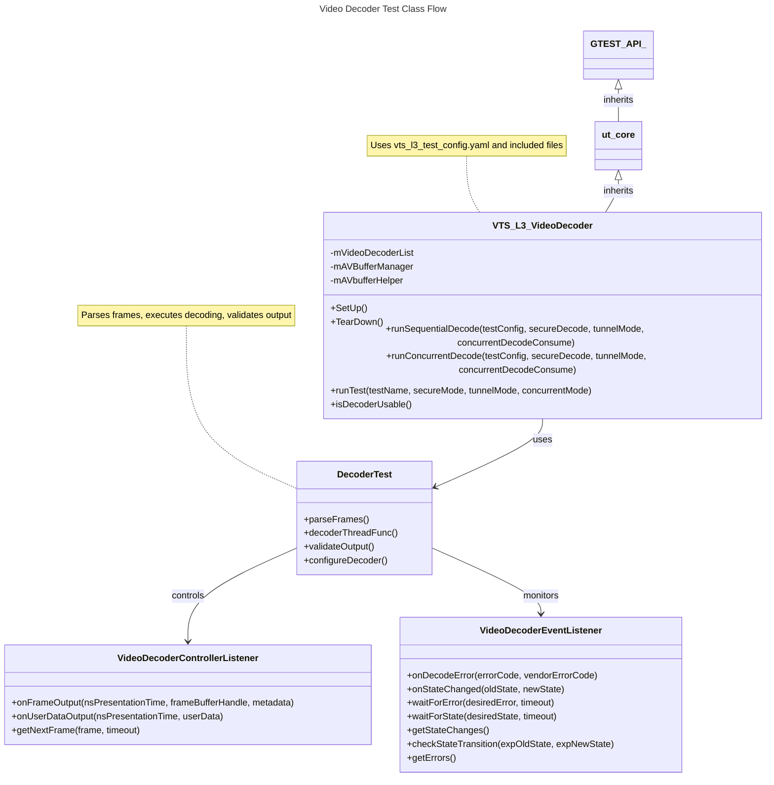
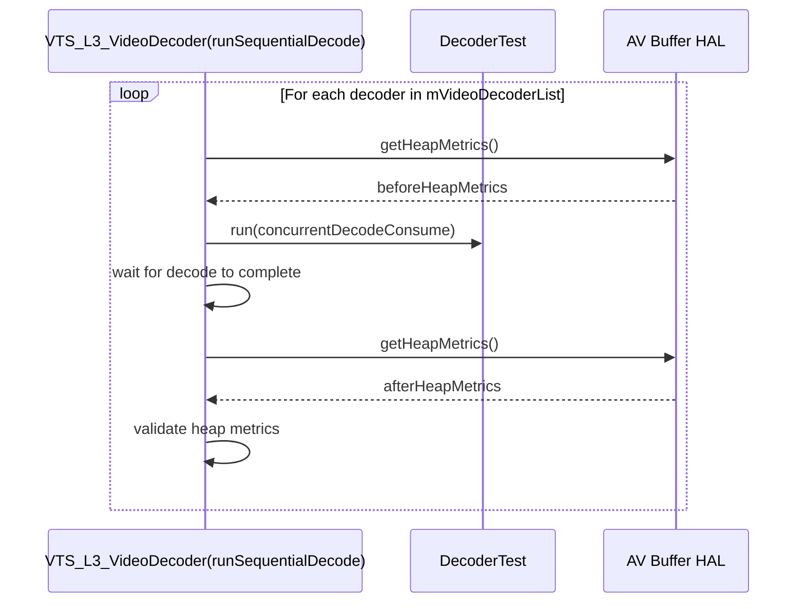
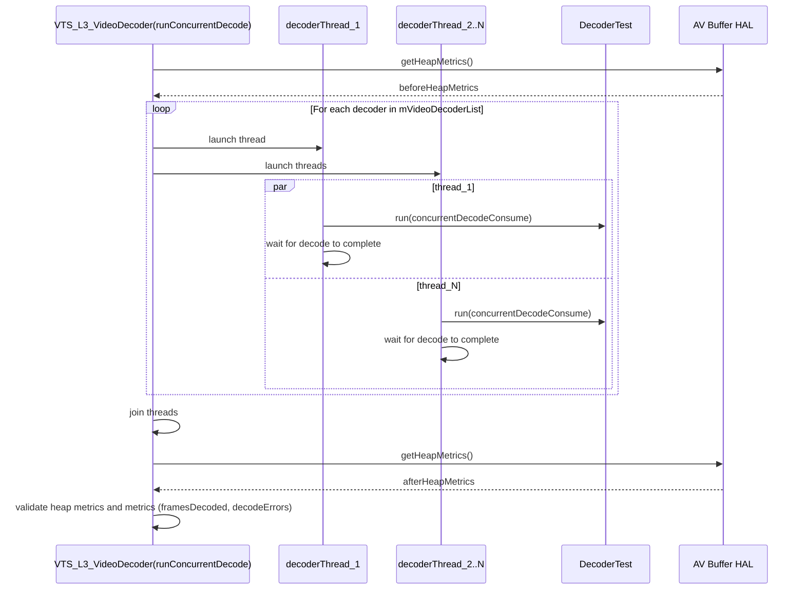
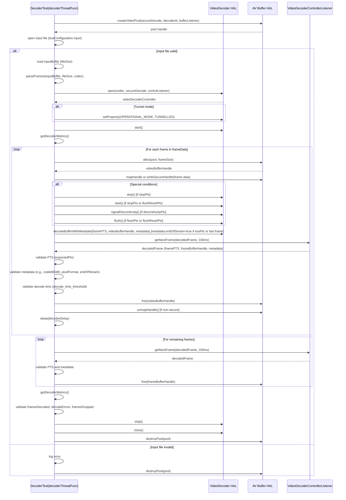
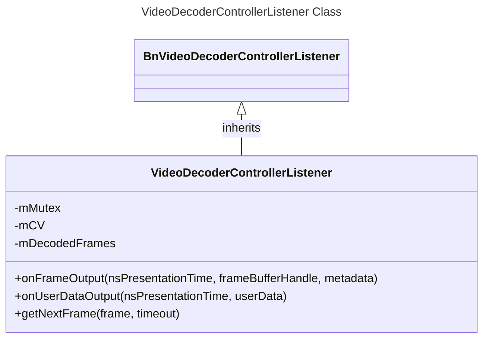
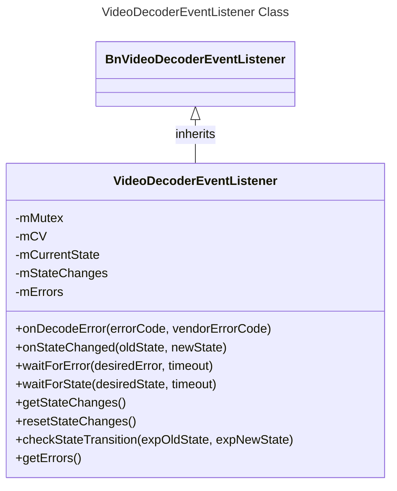
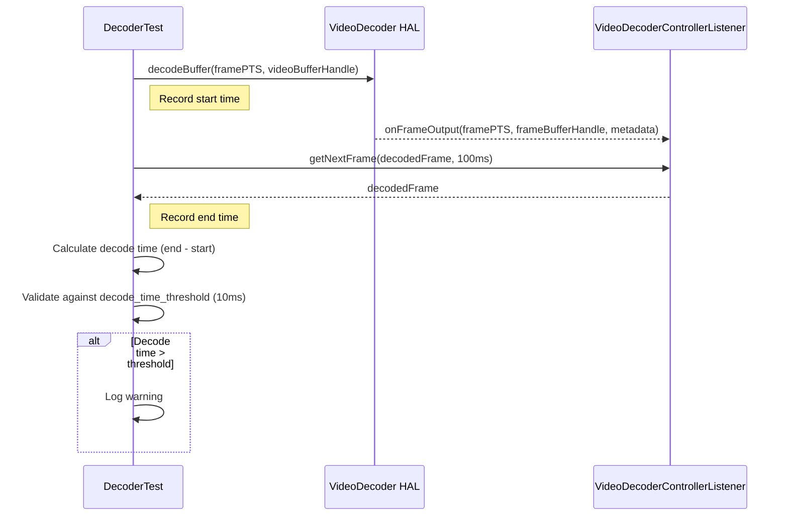
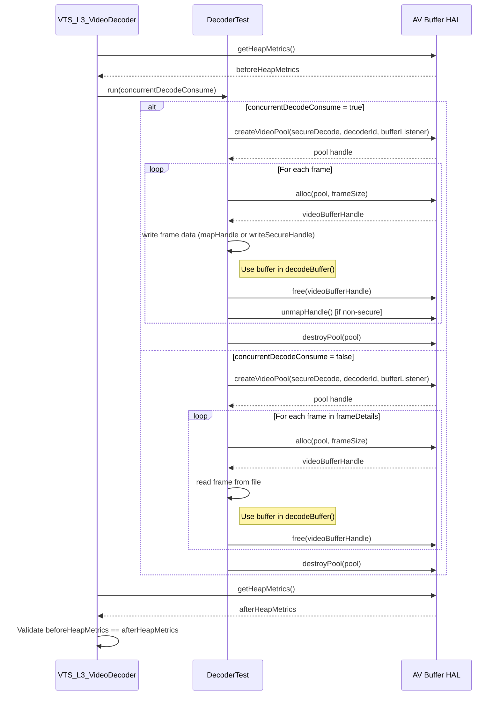

# VIDEO DECODER L3 Low Level Test Specification and Procedure Documentation

## Table of Contents

- [Overview](#overview)
- [Acronyms, Terms and Abbreviations](#acronyms-terms-and-abbreviations)
- [References](#references)
- [Test Configuration](#test-configuration)
- [Class Design](#video-decoder-test-suite-class-design)
- [Common Validation Functions](#common-validation-functions)
- [L3 Tests](#l3-tests)

## Acronyms, Terms and Abbreviations

- `HAL` \- Hardware Abstraction Layer, may include some common components
- `UT`  \- Unit Test(s)
- `rms`  \- Root Mean Square
- `YAML` \- Yet Another Markup Language
- `PTS` \- Presentation Time Stamp
- `EOS` \- End of Stream

## Overview

This document describes the `L3` Low Level Test Specification and Procedure Documentation for the Video Decoder.

## References

- High Level Test Specification - [VideoDecoder_High-Level_TestSpec](VideoDecoder_High-Level_TestSpec.md)
- `HAL` Interface Header [Interface Header](https://github.com/rdkcentral/rdk-halif-aidl/tree/v0.7/videodecoder/current/com/rdk/hal/videodecoder)
- `HAL` specification documentation in this link - [Video Decoder HAL Specification info](https://rdkcentral.github.io/rdk-halif-aidl/halif/video_decoder/current/video_decoder/)
- Video test streams: [Video TestStreams](VideoDecoder_TestStreamsInfo.md)

## Test Configuration

The test configuration in [vts_l3_test_config.yaml](../../test_configuration/vts_l3_test_config.yaml) manages input and reference streams, control parameters, and validation criteria for sequential and concurrent decoding in non-tunnel, non-secure modes. It integrates with the test framework via `vts_videodecoder_parse_testconfig`, enabling the `DecoderTest` class to execute and validate decoding operations across various codecs (`H.264`, `H.26`5, `VP9`, and `AV1`) and scenarios (e.g., error handling, `GOP` structures, discontinuity, `EOS`, flush, resolutions, `HDR`
 modes, frame rates, low-latency, adaptive bitrate).

### Example Test Configuration File

```yaml
include_0: test_configuration/vts_video_h264_streams.yaml
include_1: test_configuration/vts_video_hevc_streams.yaml
include_2: test_configuration/vts_video_vp9_streams.yaml
include_3: test_configuration/vts_video_av1_streams.yaml

IVideoDecoderManager:
  stream_download_path: "http://<>/streams" #`URL` path to download the video test streams
  input_streams_path: "test_configuration" #Target path where input streams are stored
  reference_streams_path: "test_configuration" #Target path for reference decoded streams
  L3: #Test Level
    VDecode_Sequential_NonTunnel_NonSecure:
      Controls:
        delay_between_decode_calls: 5
      Inputs:
        Streams:
          - Codec: H264
            Name: H264_HIGH_1920x1080_DR_SDR_DR_BT709_60p_PIXEL_FORMAT_YCBCR420_734
            rms_diff_threshold: 0.5
            decode_time_threshold: 10000000
          - Codec: H265
            Name: H265_HIGH_1920x1080_DR_SDR_DR_BT709_30p_PIXEL_FORMAT_YCBCR420_734
            rms_diff_threshold: 0.5
            decode_time_threshold: 10000000
          - Codec: VP9
            Name: VP9_HIGH_1920x1080_DR_SDR_DR_BT709_30p_PIXEL_FORMAT_YCBCR420_734
            rms_diff_threshold: 0.5
            decode_time_threshold: 10000000
```

#### Key Parameters

- **Stream Name** (e.g., `H264_HIGH_1920x1080_DR_SDR_DR_BT709_60p_PIXEL_FORMAT_YCBCR420_734`):
- `input`: Input stream file (e.g., `H264_..._734.es`).
- `codec`: Codec type (e.g., `H264`).
- `codedWidth`/`codedHeight`: Resolution (e.g., 1920x1080).
- `colorDepth`: Bit depth (e.g., 8-bit).
- `pixelFormat`: Format (e.g., `YCBCR420`).
- `dynamic_range`: SDR or HDR (e.g., `SDR`).
- `scanType`: Scan type (e.g., `PROGRESSIVE_FRAME`).
- `frameRateNumerator`/`frameRateDenominator`: Frame rate (e.g., 60/1 for 60fps).
- `endOfStream`: Indicates EOS signal (0 for no, 1 for yes).
- `stop_start_pts`: PTS (in nanoseconds) for stopping/restarting the decoder (-1 for none).
- `signal_discontinuity_pts`: PTS for signalling discontinuity (e.g., 100000000 for 100ms, -1 for none).
- `flush_pts`: PTS for flushing the decoder (e.g., 133333000 for 133.33ms, -1 for none).
- `flush_reset_pts`: PTS for flushing with reset (e.g., 166667000 for 166.67ms, -1 for none).
- `eos_pts`: PTS for sending EOS signal (e.g., 183333000 for 183.33ms, -1 for none).
- `discontinuity`: Indicates discontinuity test (0 for no, 1 for yes).
- `lowLatency`: Indicates low-latency mode (0 for no, 1 for yes).
- `bit_rate`: Stream bit rate (e.g., 734kbps).
- `no_of_frames`: Number of frames (e.g., 12 or 126 for GOP tests).
- `decodeErrors`: Expected decode errors (e.g., 0, 2, or 3 for error tests).
- `framesDropped`: Expected dropped frames (e.g., 0).
- `frame_size`: List of frame sizes in bytes (e.g., [733, 31, 11, ...]).
- `PTS`: List of Presentation Time Stamps per frame in nanoseconds (e.g., [0, 0, ..., 183333000]).
- **Role**: Provides detailed frame metadata for parsing in `DecoderTest::parseFrames`, specifies test conditions (e.g., errors, discontinuities, EOS), and defines expected validation metrics (e.g., `decodeErrors`, `framesDropped`).

### Example Stream Configuration File

```yaml
VideoStreams:
  H264_HIGH_1920x1080_DR_SDR_DR_BT709_60p_PIXEL_FORMAT_YCBCR420_734:
    input: H264_HIGH_1920x1080_DR_SDR_DR_BT709_60p_PIXEL_FORMAT_YCBCR420_734.es #Stream Name
    #reference: H264_HIGH_1920x1080_DR_SDR_DR_BT709_60p_PIXEL_FORMAT_YCBCR420_734.yuv #reference decoder output
    codec: H264  #Video codec information, Refer `Codec` enum
    codedWidth: 1920
    codedHeight: 1080
    colorDepth: 8
    pixelFormat: YCBCR420
    dynamic_range: SDR #com.rdk.hal.video.decoder.DynamicRange enum.
    scanType: PROGRESSIVE_FRAME
    frameRateNumerator: 60 #Frame Rate
    frameRateDenominator: 1
    endOfStream: 0
    stop_start_pts: -1 #`pts` value in nano seconds at which the decoder should be stopped and restarted during the test. -1 indicates that decoder should not be restarted
    signal_discontinuity_pts: -1 #`pts` value in nano seconds at which the test should signal discontinuity to the decoder. -1 indicates that no discontinuity signal should be sent
    flush_pts: -1 #`pts` value in nano seconds that determine when the test should flush the decoder. -1 indicates that test should not flush
    flush_reset_pts: -1 #`pts` value in nano seconds that determine when the test should flush with reset the decoder. -1 indicates that test should not flush
    eos_pts: -1 #`pts` value in nano seconds that determine when the test should sent `eos` signal to decoder. -1 indicates that test should not signal `eos`
    discontinuity: 0
    lowLatency: 0
    bit_rate: 734
    no_of_frames: 12
    decodeErrors: 0
    framesDropped: 0
    frame_size:
      - 733
      - 31
      - 11
      - 732
      - 108718
      - 2897
      - 1076
      - 1043
      - 1101
      - 1198
      - 1092
      - 715
      - 4040
      - 1260
      - 1390
      - 1490
    PTS: #List of Presentation Time Stamps (per frame) in nanoseconds
      - 00000000
      - 00000000
      - 00000000
      - 00000000
      - 00000000
      - 116667000
      - 50000000
      - 16667000
      - 33333000
      - 66667000
      - 83333000
      - 100000000
      - 183333000
      - 166667000
      - 133333000
      - 150000000
```

## Video Decoder Test Suite Class Design

The video decoder test suite validates the functionality of the Video Decoder Hardware Abstraction Layer (HAL) for Level 3 (L3) tests, covering sequential and concurrent decoding scenarios for codecs like H.264, H.265, VP9, and potentially AV1. It leverages the C++ variant of the `ut-core` testing framework for test orchestration and integrates with `vts_l3_test_config.yaml` to manage input streams, control parameters, and validation criteria.

## Primary Classes

| # | Class | Description |
|---|-------|-------------|
| 1 | `VTS_L3_VideoDecoder` | Main test class containing L3 video decoder test cases, inherited from `ut-core`. |
| 2 | `DecoderTest` | Helper class for managing video decoding operations, including frame parsing and validation. |
| 3 | `VideoDecoderControllerListener` | Listener class for handling control events (e.g., start, stop, flush). |
| 4 | `VideoDecoderEventListener` | Listener class for handling decoder events (e.g., errors, EOS, discontinuities). |

## Class Details

### 1. `VTS_L3_VideoDecoder` Class

- **Description**: Implements L3 test cases for the Video Decoder HAL, inheriting from `ut-core`’s `GTEST_API_` (via `ut_core`) to leverage Google Test functionality. It orchestrates test execution, configuration parsing, and validation using `vts_l3_test_config.yaml`.
- **Key Methods**:
  - `SetUp()`: Initializes the test environment, parsing `vts_l3_test_config.yaml` via `vts_videodecoder_parse_testconfig` to populate `testConfiguration_t` with stream metadata (e.g., codec, input file, PTS, frame sizes).
  - `TearDown()`: Cleans up resources, such as closing decoder instances and releasing stream buffers.
  - `runSequentialDecode()`: Executes sequential decoding tests (e.g., `VDecode_Sequential_NonTunnel_NonSecure`), processing one stream at a time using `DecoderTest::decoderThreadFunc`.
  - `runConcurrentDecode()`: Executes concurrent decoding tests (e.g., `VDecode_Concurrent_NonTunnel_NonSecure`), managing multiple streams using `DecoderTest::decoderThreadFunc`.
  - `runSingleProcessTest()`: Runs individual test cases, handling scenarios like error, discontinuity, or EOS with test-specific parameters (e.g., `signal_discontinuity_pts`, `eos_pts`).
  - `isDecoderUsable()`: Checks if the video decoder is available and functional for testing.
- **Dependencies**: Uses `vts_l3_test_config.yaml` and included files (e.g., `vts_video_h264_streams.yaml`) for configuration, interacts with `DecoderTest` for decoding.
- **Role**: Orchestrates test execution, validates decoder behaviour against metrics like `rms_diff_threshold` and `decode_time_threshold`, and reports results via `ut-core`.

### 2. `DecoderTest` Class

- **Description**: Manages video decoding operations, including stream parsing, frame processing, and validation. Interacts with the Video Decoder HAL using `testConfiguration_t`.
- **Key Methods**:
  - `parseFrames()`: Parses input stream frames using `frameDetails` from included YAML files (e.g., `vts_video_h264_streams.yaml`) for H.264/H.265 or calculates boundaries for VP9/AV1.
  - `decoderThreadFunc()`: Executes decoding in a thread, handling sequential or concurrent streams, applying test conditions (e.g., flush at `flush_pts`, EOS at `eos_pts`), and collecting metrics (e.g., frames decoded, errors, dropped frames).
  - `validateOutput()`: Compares decoded frames against reference streams (from `reference_streams_path`) using `rms_diff_threshold` and checks decode times against `decode_time_threshold`.
  - `configureDecoder()`: Sets up the decoder with stream parameters (e.g., `codedWidth`, `codedHeight`, `pixelFormat`, `frameRateNumerator`).
- **Dependencies**: Relies on `testConfiguration_t` for metadata (e.g., `frame_size`, `PTS`, `decodeErrors`) and interacts with `VideoDecoderControllerListener` and `VideoDecoderEventListener`.
- **Role**: Handles core decoding logic, ensuring frames are processed and test conditions are applied.

### 3. `VideoDecoderControllerListener` Class

- **Description**: Handles control events for the video decoder, such as starting, stopping, flushing, or resetting during tests.
- **Key Methods**:
  - `onStart()`: Signals the decoder to begin processing a stream.
  - `onStop()`: Stops the decoder at `stop_start_pts`.
  - `onFlush(pts)`: Triggers a flush at `flush_pts` or `flush_reset_pts`.
  - `onReset()`: Resets the decoder for tests like `VDecode_Sequential_NonTunnel_NonSecure_FlushReset`.
- **Dependencies**: Receives control signals from `DecoderTest::decoderThreadFunc` based on PTS values (e.g., `flush_pts`, `flush_reset_pts`).
- **Role**: Manages decoder control operations for test scenarios.

### 4. `VideoDecoderEventListener` Class

- **Description**: Captures and processes decoder events, such as errors, EOS, or discontinuities, for validation.
- **Key Methods**:
  - `onError(errorCode)`: Records decode errors (compared against `decodeErrors`, e.g., 3 for `H264_..._ERROR`).
  - `onEOS(pts)`: Handles EOS signals at `eos_pts` (e.g., 183333000ns for `H264_..._EOS`).
  - `onDiscontinuity(pts)`: Processes discontinuities at `signal_discontinuity_pts` (e.g., 100000000ns for `H264_..._DISCONTINUITY`).
  - `onFrameDecoded(frame)`: Logs decoded frames for validation against `no_of_frames` and `framesDropped`.
- **Dependencies**: Monitors events from `DecoderTest::decoderThreadFunc` and validates against `testConfiguration_t` metrics.
- **Role**: Ensures test conditions are correctly handled and reported.

## Class Diagram



## VTS_L3_VideoDecoder Class Functions

The class overrides `SetUp()` and `TearDown()` from `UTCore` to handle initialization and cleanup common to all test cases.

| # | Function | Arguments | Description | HAL API |
|---|----------|----------|-------------|---------|
| 1 | `SetUp` | None | Initializes the test by parsing the Hardware Feature Profile (HFP), acquiring decoder IDs, capabilities, and registering listeners. Populates `mVideoDecoderList` and initializes buffer services. | `getVideoDecoderIds()`<br>`getVideoDecoder()`<br>`registerEventListener()`<br>`getCapabilities()`<br>`getAVBufferService()` |
| 2 | `TearDown` | None | Cleans up by unregistering event listeners and clearing `mVideoDecoderList`. | `unregisterEventListener()` |
| 3 | `runSequentialDecode` | `testConfiguration_t& testConfig`<br>`bool secureDecode`<br>`bool tunnelMode`<br>`bool concurrentDecodeConsume` | Decodes streams sequentially using `DecoderTest` for each supported decoder, validating codec support and heap metrics. | `getHeapMetrics()` |
| 4 | `runConcurrentDecode` | `testConfiguration_t& testConfig`<br>`bool secureDecode`<br>`bool tunnelMode`<br>`bool concurrentDecodeConsume` | Launches multiple threads to decode streams concurrently using `DecoderTest`, validating frame counts, errors, and heap metrics. | `getHeapMetrics()` |
| 5 | `runTest` | `char* testName`<br>`bool secureMode`<br>`bool tunnelMode`<br>`bool concurrentMode` | Checks that the requested operational mode and secure-decoding capability are supported. Unsupported tunnelled, non-tunnelled, or secure tests are reported as skipped; otherwise, parses test configurations and invokes `runConcurrentDecode` or `runSequentialDecode` based on `concurrentMode`. | `getSupportedOperationalModes()` |

### SetUp

The following sequence diagram illustrates the flow of the `SetUp` function:

```mermaid
sequenceDiagram
  participant VTS_L3_VideoDecoder_SetUp as VTS_L3_VideoDecoder(SetUp)
  participant VideoDecoder_HAL as VideoDecoder HAL
  participant AVBuffer_HAL as AV Buffer HAL

  VTS_L3_VideoDecoder_SetUp->>VideoDecoder_HAL: vts_videodecoder_parseVideoDecoderHFP()
  VTS_L3_VideoDecoder_SetUp->>AVBuffer_HAL: getAVBufferService()
  AVBuffer_HAL-->>VTS_L3_VideoDecoder_SetUp: mAVBufferManager
  VTS_L3_VideoDecoder_SetUp->>AVBuffer_HAL: getAVBufferHelperInstance()
  AVBuffer_HAL-->>VTS_L3_VideoDecoder_SetUp: mAVbufferHelper
  VTS_L3_VideoDecoder_SetUp->>VideoDecoder_HAL: getVideoDecoderIds()
  VideoDecoder_HAL-->>VTS_L3_VideoDecoder_SetUp: list of decoder IDs
  loop For each decoder ID
    VTS_L3_VideoDecoder_SetUp->>VideoDecoder_HAL: getVideoDecoder()
    VideoDecoder_HAL-->>VTS_L3_VideoDecoder_SetUp: decoder handle
    VTS_L3_VideoDecoder_SetUp->>VideoDecoder_HAL: registerEventListener()
    VTS_L3_VideoDecoder_SetUp->>VideoDecoder_HAL: getCapabilities()
    VideoDecoder_HAL-->>VTS_L3_VideoDecoder_SetUp: decoder capabilities
  end

  ```

#### TearDown

The following sequence diagram illustrates the flow of the `TearDown` function:

```mermaid
sequenceDiagram
  participant VTS_L3_VideoDecoder_TearDown as VTS_L3_VideoDecoder(TearDown)
  participant VideoDecoder_HAL as VideoDecoder HAL

  loop For each decoder in mVideoDecoderList
    VTS_L3_VideoDecoder_TearDown->>VideoDecoder_HAL: unregisterEventListener()
  end
```

#### runSequentialDecode

The following sequence diagram illustrates the flow of the runSequentialDecode function:mermaid



#### runConcurrentDecode

The following sequence diagram illustrates the flow of the runConcurrentDecode function:mermaid



### DecoderTest Class Functions

| # | Function | Arguments | Description | HAL API |
|---|----------|----------|-------------|---------|
| 1 | `decodeAndConsumeVideoStreams` | None | Decodes and consumes video frames sequentially, allocating buffers, decoding frames, and validating metadata (e.g., `codedWidth`, `pixelFormat`) and metrics (e.g., decode time). Used in non-concurrent mode. | `createVideoPool()`<br>`alloc()`<br>`free()`<br>`destroyPool()`<br>`open()`<br>`start()`<br>`decodeBuffer()`<br>`stop()`<br>`close()` |
| 2 | `run` | `bool concurrentDecodeConsume` | Executes decoding by calling `decodeAndConsumeVideoStreams` (non-concurrent mode) or launching `decoderThreadFunc` (concurrent mode). Currently, only concurrent mode is used (`concurrentDecodeConsume = true`). | None |
| 3 | `getDecoderMetrics` | `int32_t& framesDecoded`<br>`int32_t& decodeErrors`<br>`int32_t& framesDropped` | Retrieves decoding metrics (`METRIC_FRAMES_DECODED`, `METRIC_DECODE_ERRORS`, `METRIC_FRAMES_DROPPED`) via `getProperty` for validation against `testConfiguration_t` (e.g., `no_of_frames`, `decodeErrors`). | `getProperty()` |
| 4 | `parseFrames` | `const std::vector<uint8_t>& inputBuffer`<br>`uint64_t fileSize`<br>`com::rdk::hal::videodecoder::Codec codec` | Parses video stream frames based on codec (H.264, H.265, MPEG, VP9, AV1), extracting offset, size, and PTS from `inputBuffer` or `frameDetails` in `testConfiguration_t`. | None |

#### decodeAndConsumeVideoStreams

The following sequence diagram illustrates the flow of the `decoderThreadFunc` function, used in non-concurrent mode (`concurrentDecodeConsume = false`):



### VideoDecoderControllerListener Class

This class handles decoded frame output callbacks from the Video Decoder HAL, collecting frames and metadata in a thread-safe deque for validation by the test framework.

| # | Function | Arguments | Description | HAL API |
|---|----------|----------|-------------|---------|
| 1 | `onFrameOutput` | `int64_t nsPresentationTime int64_t frameBufferHandle std::optional<com::rdk::hal::videodecoder::FrameMetadata> metadata` | Logs and stores decoded frames in mDecodedFrames as DecodedVideoFrame_t, including framePTS, frameBufferHandle, and metadata (e.g., codedWidth, sha1). | None |
| 2 | `onUserDataOutput` | `int64_t nsPresentationTime std::vector<uint8_t> userData` | Logs user data output events. | None |
| 3 | `getNextFrame` | `DecodedVideoFrame_t& frame std::chrono::milliseconds timeout` | Retrieves the next decoded frame from mDecodedFrames with a timeout, using thread-safe synchronization. | None |



### VideoDecoderEventListener Class

This class handles decoder error and state change callbacks, collecting metrics in thread-safe collections for validation.

VideoDecoderEventListener Class Functions

#### VideoDecoderEventListener Class Functions

The following table describes the functions of the `VideoDecoderEventListener` class, including their arguments, descriptions, and corresponding HAL API mappings.

| # | Function | Arguments | Description | HAL API |
|---|----------|-----------|-------------|---------|
| 1 | `onDecodeError` | `ErrorCode errorCode`<br>`int32_t vendorErrorCode` | Logs and stores errors in `mErrors`, validated against `decodeErrors` (e.g., 3 for H264_..._ERROR streams). | None |
| 2 | `onStateChanged` | `State oldState`<br>`State newState` | Logs and stores state transitions in `mStateChanges`, updating `mCurrentState` (e.g., from `CLOSED` to `OPENING`). | None |
| 3 | `waitForError` | `ErrorCode desiredError`<br>`std::chrono::milliseconds timeout` | Waits for a specific error using the condition variable `mCV`. | None |
| 4 | `waitForState` | `State desiredState`<br>`std::chrono::milliseconds timeout` | Waits for a specific decoder state (e.g., `RUNNING`). | None |
| 5 | `getStateChanges` | None | Returns recorded state transitions for verification. | None |
| 6 | `resetStateChanges` | None | Clears `mStateChanges` for new tests. | None |
| 7 | `checkStateTransition` | `State expOldState`<br>`State expNewState` | Verifies that a specific state transition occurred. | None |
| 8 | `getErrors` | None | Returns recorded errors for validation. | None |



## Common Validation Functions

### Validate Decoder Metrics

The following decoder metrics are validated before and after decoding to ensure accurate tracking:

- `METRIC_FRAMES_DECODED`: Number of successfully decoded frames, compared against `testConfiguration_t::no_of_frames - testConfiguration_t::decodeErrors`.
- `METRIC_DECODE_ERRORS`: Number of decode errors, compared against `testConfiguration_t::decodeErrors` (e.g., 3 for `H264_..._ERROR`).
- `METRIC_FRAMES_DROPPED`: Number of dropped frames, compared against `testConfiguration_t::framesDropped`.

These metrics are retrieved using the `getProperty()` API via `DecoderTest::getDecoderMetrics`. The test confirms that metrics increment correctly during decoding, with final validation in `decoderThreadFunc` using assertions like `UT_ASSERT_EQUAL(framesDecoded, no_of_frames - decodeErrors)`.

#### Implementation Details

- **Method**: `DecoderTest::getDecoderMetrics(int32_t& framesDecoded, int32_t& decodeErrors, int32_t& framesDropped)`
- **Validation**: Performed in `decoderThreadFunc` (concurrent mode) or `decodeAndConsumeVideoStreams` (non-concurrent mode).
- **Assertions**:
  - `framesDecoded == no_of_frames - decodeErrors`
  - `decodeErrors == testConfiguration_t::decodeErrors`
  - `framesDropped == testConfiguration_t::framesDropped`
- **HAL API**: `getProperty()` for properties `METRIC_FRAMES_DECODED`, `METRIC_DECODE_ERRORS`, and `METRIC_FRAMES_DROPPED`.

#### Validate Decode Time

The time taken to decode each frame is calculated as the difference between the `decodeBuffer()` call and the corresponding `onFrameOutput()` event (received via `VideoDecoderControllerListener::getNextFrame`). The result is validated against the `decode_time_threshold` (10ms) specified in `vts_l3_test_config.yaml`. A warning is logged if the decode time exceeds the threshold.

- **Method**:
  - In `decoderThreadFunc` (concurrent mode): Measures time from `decodeBuffer` to `getNextFrame`, logged as `decodeTimeNs`.
  - In `decodeAndConsumeVideoStreams` (non-concurrent mode): Measures time from `decodeBuffer` to `getNextFrame`, logged as `duration`.
- **Validation**: Compares `decodeTimeNs` (or `duration`) against `testConfiguration_t::decode_time_threshold`.
- **HAL APIs**: `decodeBuffer()`, `getNextFrame()` (via `VideoDecoderControllerListener`).
- **Sequence Diagram**:



### Validate AV Buffers

This validation ensures that both the test suite and the Video Decoder HAL properly release allocated video buffers to prevent memory leaks. It compares memory usage at the beginning and end of each test using the `getHeapMetrics()` API, called in `VTS_L3_VideoDecoder::runSequentialDecode` and `runConcurrentDecode`. Buffer allocation and deallocation are handled in `DecoderTest::decoderThreadFunc` (concurrent mode) and `decodeAndConsumeVideoStreams` (non-concurrent mode), ensuring no unreleased buffers remain.

- **Method**:
  - Heap metrics: Checked in `VTS_L3_VideoDecoder::runSequentialDecode` and `runConcurrentDecode` via `getHeapMetrics()`.
  - Buffer management: Performed in `DecoderTest::decoderThreadFunc` and `decodeAndConsumeVideoStreams`.
- **Process**:
  - Before decoding: Call `getHeapMetrics()` to capture `beforeHeapMetrics`.
  - During decoding: Allocate buffers (`alloc`), decode frames (`decodeBuffer`), and free buffers (`free`).
  - After decoding: Call `getHeapMetrics()` to capture `afterHeapMetrics` and destroy the video pool (`destroyPool`).
  - Compare `beforeHeapMetrics` and `afterHeapMetrics` to confirm no memory leaks.
- **HAL APIs**:
  - `getHeapMetrics()`: Retrieves heap usage metrics.
  - `createVideoPool()`: Creates a video buffer pool.
  - `alloc()`: Allocates a buffer for frame data.
  - `free()`: Releases allocated buffers.
  - `destroyPool()`: Destroys the video buffer pool.
- **Sequence Diagram**:



### Validate Metadata

This validation ensures that metadata for each decoded frame matches the expected configuration, verifying the Video Decoder HAL’s accuracy for codecs like H.264, H.265, VP9, and AV1. Metadata is retrieved via `VideoDecoderControllerListener::getNextFrame` and validated against `testConfiguration_t` fields using assertions.

- **Method**:
  - Primary: `DecoderTest::decoderThreadFunc` (concurrent mode, `concurrentDecodeConsume = true`).
  - Secondary: `DecoderTest::decodeAndConsumeVideoStreams` (non-concurrent mode, limited to checking frame data presence).
- **Process**:
  - Retrieve `DecodedVideoFrame_t` via `VideoDecoderControllerListener::getNextFrame` with a 100ms timeout.
  - Check `isMetaAvailable` to confirm metadata presence.
  - Validate `FrameMetadata` fields against `testConfiguration_t` using `UT_ASSERT_EQUAL`.
  - Log mismatches with codec context (e.g., `videodecoder::toString(codec)`).
- **Validated Fields** (from `FrameMetadata`):
  - `codedWidth`, `codedHeight`: Matches `testConfiguration_t::codedWidth`, `codedHeight` (e.g., 1920x1080).
  - `pixelFormat`: Matches `testConfiguration_t::pixelFormat` (e.g., YUV420).
  - `colorDepth`: Matches `testConfiguration_t::colorDepth` (e.g., 8-bit).
  - `dynamicRange`: Matches `testConfiguration_t::dynamicRange` (e.g., SDR, HDR).
  - `frameRateNumerator`, `frameRateDenominator`: Matches `testConfiguration_t::frameRateNumerator`, `frameRateDenominator` (e.g., 30/1 for 30fps).
  - `scanType`: Matches `testConfiguration_t::scanType` (e.g., progressive).
  - `endOfStream`, `discontinuity`, `lowLatency`: Matches corresponding `testConfiguration_t` flags.
  - Commented-out fields: `activeX`, `activeY`, `activeWidth`, `activeHeight`, `parX`, `parY`, `sarX`, `sarY`, `afd`, `source`, `sha1` (available but not currently validated).
- **Validation Example** (from `decoderThreadFunc`):

  ```cpp
  UT_ASSERT_EQUAL(decodedFrame.metadata->codedWidth, mTestConfiguration.codedWidth)
      << "Width mismatch: expected=" << mTestConfiguration.codedWidth
      << ", actual=" << decodedFrame.metadata->codedWidth
      << ", for Codec " << videodecoder::toString(mTestConfiguration.codec).c_str();

## L3 Tests

`Currently, the L3 test suite for the video decoder is limited to testing H.264, HEVC, and VP9 codecs in Non-Tunnel and Non-Secure modes, exclusively with HD stream`

## Test Case Table

| #   | Test Name                                           | Function                | Arguments                                      | Test Configuration Controls                        |
|-----|----------------------------------------------------|-------------------------|-----------------------------------------------|--------------------------------------------------|
| 1   | VDecode_Sequential_NonTunnel_NonSecure              | runSingleProcessTest    | secureMode = false<br>tunnelMode = false<br>concurrentMode = false | Inputs.Streams                                   |
| 2   | VDecode_Sequential_NonTunnel_NonSecure_Error        | runSingleProcessTest    | secureMode = false<br>tunnelMode = false<br>concurrentMode = false | Inputs.Streams<br>Controls.error_streams         |
| 3   | VDecode_Sequential_NonTunnel_NonSecure_GOP          | runSingleProcessTest    | secureMode = false<br>tunnelMode = false<br>concurrentMode = false | Inputs.Streams<br>Controls.gop_structure         |
| 4   | VDecode_Sequential_NonTunnel_NonSecure_Discontinuity| runSingleProcessTest    | secureMode = false<br>tunnelMode = false<br>concurrentMode = false | Inputs.Streams<br>Controls.signal_discontinuity_pts |
| 5   | VDecode_Sequential_NonTunnel_NonSecure_EOS         | runSingleProcessTest    | secureMode = false<br>tunnelMode = false<br>concurrentMode = false | Inputs.Streams<br>Controls.eos_pts               |
| 6   | VDecode_Sequential_NonTunnel_NonSecure_Flush        | runSingleProcessTest    | secureMode = false<br>tunnelMode = false<br>concurrentMode = false | Inputs.Streams<br>Controls.flush_pts             |
| 7   | VDecode_Sequential_NonTunnel_NonSecure_FlushReset   | runSingleProcessTest    | secureMode = false<br>tunnelMode = false<br>concurrentMode = false | Inputs.Streams<br>Controls.flush_reset_pts       |
| 8   | VDecode_Concurrent_NonTunnel_NonSecure             | runConcurrentDecode     | secureMode = false<br>tunnelMode = false<br>concurrentMode = true  | Inputs.Streams                                   |
| 12  | Decode_NonTunnel_NonSecure_Error_Discontinuity    | runSingleProcessTest    | secureMode = false<br>tunnelMode = false<br>concurrentMode = false | Inputs.Streams<br>Controls.error_streams<br>Controls.signal_discontinuity_pts |
| 13  | Decode_NonTunnel_NonSecure_Error_EOS              | runSingleProcessTest    | secureMode = false<br>tunnelMode = false<br>concurrentMode = false | Inputs.Streams<br>Controls.error_streams<br>Controls.eos_pts |
| 14  | Decode_NonTunnel_NonSecure_Discontinuity_EOS      | runSingleProcessTest    | secureMode = false<br>tunnelMode = false<br>concurrentMode = false | Inputs.Streams<br>Controls.signal_discontinuity_pts<br>Controls.eos_pts |
| 15  | Decode_NonTunnel_NonSecure_Flush_Error            | runSingleProcessTest    | secureMode = false<br>tunnelMode = false<br>concurrentMode = false | Inputs.Streams<br>Controls.flush_pts<br>Controls.error_streams |
| 16  | Decode_NonTunnel_NonSecure_FlushReset_Error       | runSingleProcessTest    | secureMode = false<br>tunnelMode = false<br>concurrentMode = false | Inputs.Streams<br>Controls.flush_reset_pts<br>Controls.error_streams |
| 18  | VDecode_Concurrent_NonTunnel_NonSecure_Error       | runConcurrentDecode     | secureMode = false<br>tunnelMode = false<br>concurrentMode = true  | Inputs.Streams<br>Controls.error_streams         |
| 19  | VDecode_Concurrent_NonTunnel_NonSecure_Discontinuity| runConcurrentDecode    | secureMode = false<br>tunnelMode = false<br>concurrentMode = true  | Inputs.Streams<br>Controls.signal_discontinuity_pts |
| 20  | VDecode_Concurrent_NonTunnel_NonSecure_EOS         | runConcurrentDecode     | secureMode = false<br>tunnelMode = false<br>concurrentMode = true  | Inputs.Streams<br>Controls.eos_pts               |
| 21  | VDecode_Concurrent_NonTunnel_NonSecure_Flush       | runConcurrentDecode     | secureMode = false<br>tunnelMode = false<br>concurrentMode = true  | Inputs.Streams<br>Controls.flush_pts             |
| 22  | VDecode_Concurrent_NonTunnel_NonSecure_FlushReset  | runConcurrentDecode     | secureMode = false<br>tunnelMode = false<br>concurrentMode = true  | Inputs.Streams<br>Controls.flush_reset_pts       |
| 23  | VDecode_Sequential_NonTunnel_NonSecure_CODEC       | runSingleProcessTest    | secureMode = false<br>tunnelMode = false<br>concurrentMode = false | Inputs.Streams<br>Controls.codec                 |
| 24  | VDecode_Sequential_NonTunnel_NonSecure_Resolutions | runSingleProcessTest    | secureMode = false<br>tunnelMode = false<br>concurrentMode = false | Inputs.Streams<br>Controls.resolution            |
| 25  | VDecode_Sequential_NonTunnel_NonSecure_HDRModes    | runSingleProcessTest    | secureMode = false<br>tunnelMode = false<br>concurrentMode = false | Inputs.Streams<br>Controls.dynamicRange          |
| 26  | VDecode_Sequential_NonTunnel_NonSecure_FrameRate   | runSingleProcessTest    | secureMode = false<br>tunnelMode = false<br>concurrentMode = false | Inputs.Streams<br>Controls.frameRate             |
| 27  | VDecode_Sequential_NonTunnel_NonSecure_LowLatency  | runSingleProcessTest    | secureMode = false<br>tunnelMode = false<br>concurrentMode = false | Inputs.Streams<br>Controls.lowLatency            |
| 28  | VDecode_Sequential_NonTunnel_NonSecure_AdaptiveBitrate | runSingleProcessTest | secureMode = false<br>tunnelMode = false<br>concurrentMode = false | Inputs.Streams<br>Controls.adaptiveBitrate       |
| 29  | VDecode_Sequential_NonTunnel_Secure_CODEC          | runSingleProcessTest    | secureMode = true<br>tunnelMode = false<br>concurrentMode = false  | Inputs.Streams<br>Controls.codec                 |
| 30  | VDecode_Sequential_NonTunnel_Secure_Discontinuity  | runSingleProcessTest    | secureMode = true<br>tunnelMode = false<br>concurrentMode = false  | Inputs.Streams<br>Controls.signal_discontinuity_pts |
| 31  | VDecode_Sequential_NonTunnel_Secure_EOS            | runSingleProcessTest    | secureMode = true<br>tunnelMode = false<br>concurrentMode = false  | Inputs.Streams<br>Controls.eos_pts               |
| 32  | VDecode_Sequential_NonTunnel_Secure_Flush          | runSingleProcessTest    | secureMode = true<br>tunnelMode = false<br>concurrentMode = false  | Inputs.Streams<br>Controls.flush_pts             |
| 33  | VDecode_Sequential_NonTunnel_Secure_FlushReset     | runSingleProcessTest    | secureMode = true<br>tunnelMode = false<br>concurrentMode = false  | Inputs.Streams<br>Controls.flush_reset_pts       |
| 34  | VDecode_Sequential_NonTunnel_Secure_Resolutions    | runSingleProcessTest    | secureMode = true<br>tunnelMode = false<br>concurrentMode = false  | Inputs.Streams<br>Controls.resolution            |
| 35  | VDecode_Sequential_NonTunnel_Secure_HDRModes       | runSingleProcessTest    | secureMode = true<br>tunnelMode = false<br>concurrentMode = false  | Inputs.Streams<br>Controls.dynamicRange          |
| 36  | VDecode_Sequential_NonTunnel_Secure_FrameRate      | runSingleProcessTest    | secureMode = true<br>tunnelMode = false<br>concurrentMode = false  | Inputs.Streams<br>Controls.frameRate             |
| 37  | VDecode_Sequential_NonTunnel_Secure_LowLatency     | runSingleProcessTest    | secureMode = true<br>tunnelMode = false<br>concurrentMode = false  | Inputs.Streams<br>Controls.lowLatency            |
| 38  | VDecode_Concurrent_NonTunnel_NonSecure_CODEC       | runConcurrentDecode     | secureMode = false<br>tunnelMode = false<br>concurrentMode = true  | Inputs.Streams<br>Controls.codec                 |
| 39  | VDecode_Concurrent_NonTunnel_NonSecure_Resolutions | runConcurrentDecode     | secureMode = false<br>tunnelMode = false<br>concurrentMode = true  | Inputs.Streams<br>Controls.resolution            |
| 40  | VDecode_Concurrent_NonTunnel_NonSecure_HDRModes    | runConcurrentDecode     | secureMode = false<br>tunnelMode = false<br>concurrentMode = true  | Inputs.Streams<br>Controls.dynamicRange          |
| 41  | VDecode_Concurrent_NonTunnel_NonSecure_FrameRate   | runConcurrentDecode     | secureMode = false<br>tunnelMode = false<br>concurrentMode = true  | Inputs.Streams<br>Controls.frameRate             |
| 42  | VDecode_Concurrent_NonTunnel_NonSecure_GOPStructure| runConcurrentDecode     | secureMode = false<br>tunnelMode = false<br>concurrentMode = true  | Inputs.Streams<br>Controls.gop_structure         |
| 43  | VDecode_Concurrent_NonTunnel_NonSecure_LowLatency  | runConcurrentDecode     | secureMode = false<br>tunnelMode = false<br>concurrentMode = true  | Inputs.Streams<br>Controls.lowLatency            |
| 44  | VDecode_Concurrent_NonTunnel_Secure_Error          | runConcurrentDecode     | secureMode = true<br>tunnelMode = false<br>concurrentMode = true  | Inputs.Streams<br>Controls.error_streams         |
| 45  | VDecode_Concurrent_NonTunnel_Secure_CODEC          | runConcurrentDecode     | secureMode = true<br>tunnelMode = false<br>concurrentMode = true  | Inputs.Streams<br>Controls.codec                 |
| 46  | VDecode_Concurrent_NonTunnel_Secure_Discontinuity  | runConcurrentDecode     | secureMode = true<br>tunnelMode = false<br>concurrentMode = true  | Inputs.Streams<br>Controls.signal_discontinuity_pts |
| 47  | VDecode_Concurrent_NonTunnel_Secure_EOS            | runConcurrentDecode     | secureMode = true<br>tunnelMode = false<br>concurrentMode = true  | Inputs.Streams<br>Controls.eos_pts               |
| 48  | VDecode_Concurrent_NonTunnel_Secure_Flush          | runConcurrentDecode     | secureMode = true<br>tunnelMode = false<br>concurrentMode = true  | Inputs.Streams<br>Controls.flush_pts             |
| 49  | VDecode_Concurrent_NonTunnel_Secure_FlushReset     | runConcurrentDecode     | secureMode = true<br>tunnelMode = false<br>concurrentMode = true  | Inputs.Streams<br>Controls.flush_reset_pts       |
| 50  | VDecode_Concurrent_NonTunnel_Secure_Resolutions    | runConcurrentDecode     | secureMode = true<br>tunnelMode = false<br>concurrentMode = true  | Inputs.Streams<br>Controls.resolution            |
| 51  | VDecode_Concurrent_NonTunnel_Secure_HDRModes       | runConcurrentDecode     | secureMode = true<br>tunnelMode = false<br>concurrentMode = true  | Inputs.Streams<br>Controls.dynamicRange          |
| 52  | VDecode_Concurrent_NonTunnel_Secure_FrameRate      | runConcurrentDecode     | secureMode = true<br>tunnelMode = false<br>concurrentMode = true  | Inputs.Streams<br>Controls.frameRate             |
| 53  | VDecode_Concurrent_NonTunnel_Secure_GOPStructure   | runConcurrentDecode     | secureMode = true<br>tunnelMode = false<br>concurrentMode = true  | Inputs.Streams<br>Controls.gop_structure         |
| 54  | VDecode_Concurrent_NonTunnel_Secure_LowLatency     | runConcurrentDecode     | secureMode = true<br>tunnelMode = false<br>concurrentMode = true  | Inputs.Streams<br>Controls.lowLatency            |
| 55  | Decode_Tunnel_NonSecure                          | runSingleProcessTest    | secureMode = false<br>tunnelMode = true<br>concurrentMode = false  | Inputs.Streams                                   |
| 56  | Decode_Tunnel_Secure                             | runSingleProcessTest    | secureMode = true<br>tunnelMode = true<br>concurrentMode = false   | Inputs.Streams                                   |
| 57  | Decode_Tunnel_NonSecure_Error                    | runSingleProcessTest    | secureMode = false<br>tunnelMode = true<br>concurrentMode = false  | Inputs.Streams<br>Controls.error_streams         |
| 58  | VDecode_Concurrent_Tunnel_NonSecure               | runConcurrentDecode     | secureMode = false<br>tunnelMode = true<br>concurrentMode = true   | Inputs.Streams                                   |
| 59  | VDecode_Sequential_Tunnel_NonSecure_CODEC         | runSingleProcessTest    | secureMode = false<br>tunnelMode = true<br>concurrentMode = false  | Inputs.Streams<br>Controls.codec                 |
| 60  | VDecode_Sequential_Tunnel_NonSecure_Discontinuity | runSingleProcessTest    | secureMode = false<br>tunnelMode = true<br>concurrentMode = false  | Inputs.Streams<br>Controls.signal_discontinuity_pts |
| 61  | VDecode_Sequential_Tunnel_NonSecure_EOS           | runSingleProcessTest    | secureMode = false<br>tunnelMode = true<br>concurrentMode = false  | Inputs.Streams<br>Controls.eos_pts               |
| 62  | VDecode_Sequential_Tunnel_NonSecure_Flush         | runSingleProcessTest    | secureMode = false<br>tunnelMode = true<br>concurrentMode = false  | Inputs.Streams<br>Controls.flush_pts             |
| 63  | VDecode_Sequential_Tunnel_NonSecure_FlushReset    | runSingleProcessTest    | secureMode = false<br>tunnelMode = true<br>concurrentMode = false  | Inputs.Streams<br>Controls.flush_reset_pts       |
| 64  | VDecode_Sequential_Tunnel_NonSecure_Resolutions   | runSingleProcessTest    | secureMode = false<br>tunnelMode = true<br>concurrentMode = false  | Inputs.Streams<br>Controls.resolution            |
| 65  | VDecode_Sequential_Tunnel_NonSecure_HDRModes      | runSingleProcessTest    | secureMode = false<br>tunnelMode = true<br>concurrentMode = false  | Inputs.Streams<br>Controls.dynamicRange          |
| 66  | VDecode_Sequential_Tunnel_NonSecure_FrameRate     | runSingleProcessTest    | secureMode = false<br>tunnelMode = true<br>concurrentMode = false  | Inputs.Streams<br>Controls.frameRate             |
| 67  | VDecode_Sequential_Tunnel_NonSecure_GOPStructure  | runSingleProcessTest    | secureMode = false<br>tunnelMode = true<br>concurrentMode = false  | Inputs.Streams<br>Controls.gop_structure         |
| 68  | VDecode_Sequential_Tunnel_NonSecure_LowLatency    | runSingleProcessTest    | secureMode = false<br>tunnelMode = true<br>concurrentMode = false  | Inputs.Streams<br>Controls.lowLatency            |
| 69  | VDecode_Sequential_Tunnel_Secure_Error            | runSingleProcessTest    | secureMode = true<br>tunnelMode = true<br>concurrentMode = false   | Inputs.Streams<br>Controls.error_streams         |
| 70  | VDecode_Sequential_Tunnel_Secure_CODEC            | runSingleProcessTest    | secureMode = true<br>tunnelMode = true<br>concurrentMode = false   | Inputs.Streams<br>Controls.codec                 |
| 71  | VDecode_Sequential_Tunnel_Secure_Discontinuity    | runSingleProcessTest    | secureMode = true<br>tunnelMode = true<br>concurrentMode = false   | Inputs.Streams<br>Controls.signal_discontinuity_pts |
| 72  | VDecode_Sequential_Tunnel_Secure_EOS              | runSingleProcessTest    | secureMode = true<br>tunnelMode = true<br>concurrentMode = false   | Inputs.Streams<br>Controls.eos_pts               |
| 73  | VDecode_Sequential_Tunnel_Secure_Flush            | runSingleProcessTest    | secureMode = true<br>tunnelMode = true<br>concurrentMode = false   | Inputs.Streams<br>Controls.flush_pts             |
| 74  | VDecode_Sequential_Tunnel_Secure_FlushReset       | runSingleProcessTest    | secureMode = true<br>tunnelMode = true<br>concurrentMode = false   | Inputs.Streams<br>Controls.flush_reset_pts       |
| 75  | VDecode_Sequential_Tunnel_Secure_Resolutions      | runSingleProcessTest    | secureMode = true<br>tunnelMode = true<br>concurrentMode = false   | Inputs.Streams<br>Controls.resolution            |
| 76  | VDecode_Sequential_Tunnel_Secure_HDRModes         | runSingleProcessTest    | secureMode = true<br>tunnelMode = true<br>concurrentMode = false   | Inputs.Streams<br>Controls.dynamicRange          |
| 77  | VDecode_Sequential_Tunnel_Secure_FrameRate        | runSingleProcessTest    | secureMode = true<br>tunnelMode = true<br>concurrentMode = false   | Inputs.Streams<br>Controls.frameRate             |
| 78  | VDecode_Sequential_Tunnel_Secure_GOPStructure     | runSingleProcessTest    | secureMode = true<br>tunnelMode = true<br>concurrentMode = false   | Inputs.Streams<br>Controls.gop_structure         |
| 79  | VDecode_Sequential_Tunnel_Secure_LowLatency       | runSingleProcessTest    | secureMode = true<br>tunnelMode = true<br>concurrentMode = false   | Inputs.Streams<br>Controls.lowLatency            |
| 80  | VDecode_Concurrent_Tunnel_NonSecure_Error         | runConcurrentDecode     | secureMode = false<br>tunnelMode = true<br>concurrentMode = true   | Inputs.Streams<br>Controls.error_streams         |
| 81  | VDecode_Concurrent_Tunnel_NonSecure_CODEC         | runConcurrentDecode     | secureMode = false<br>tunnelMode = true<br>concurrentMode = true   | Inputs.Streams<br>Controls.codec                 |
| 82  | VDecode_Concurrent_Tunnel_NonSecure_Discontinuity | runConcurrentDecode     | secureMode = false<br>tunnelMode = true<br>concurrentMode = true   | Inputs.Streams<br>Controls.signal_discontinuity_pts |
| 83  | VDecode_Concurrent_Tunnel_NonSecure_EOS           | runConcurrentDecode     | secureMode = false<br>tunnelMode = true<br>concurrentMode = true   | Inputs.Streams<br>Controls.eos_pts               |
| 84  | VDecode_Concurrent_Tunnel_NonSecure_Flush         | runConcurrentDecode     | secureMode = false<br>tunnelMode = true<br>concurrentMode = true   | Inputs.Streams<br>Controls.flush_pts             |
| 85  | VDecode_Concurrent_Tunnel_NonSecure_FlushReset    | runConcurrentDecode     | secureMode = false<br>tunnelMode = true<br>concurrentMode = true   | Inputs.Streams<br>Controls.flush_reset_pts       |
| 86  | VDecode_Concurrent_Tunnel_NonSecure_Resolutions   | runConcurrentDecode     | secureMode = false<br>tunnelMode = true<br>concurrentMode = true   | Inputs.Streams<br>Controls.resolution            |
| 87  | VDecode_Concurrent_Tunnel_NonSecure_HDRModes      | runConcurrentDecode     | secureMode = false<br>tunnelMode = true<br>concurrentMode = true   | Inputs.Streams<br>Controls.dynamicRange          |
| 88  | VDecode_Concurrent_Tunnel_NonSecure_FrameRate     | runConcurrentDecode     | secureMode = false<br>tunnelMode = true<br>concurrentMode = true   | Inputs.Streams<br>Controls.frameRate             |
| 89  | VDecode_Concurrent_Tunnel_NonSecure_GOPStructure  | runConcurrentDecode     | secureMode = false<br>tunnelMode = true<br>concurrentMode = true   | Inputs.Streams<br>Controls.gop_structure         |
| 90  | VDecode_Concurrent_Tunnel_NonSecure_LowLatency    | runConcurrentDecode     | secureMode = false<br>tunnelMode = true<br>concurrentMode = true   | Inputs.Streams<br>Controls.lowLatency            |
| 91  | VDecode_Concurrent_Tunnel_Secure                  | runConcurrentDecode     | secureMode = true<br>tunnelMode = true<br>concurrentMode = true    | Inputs.Streams                                   |
| 92  | VDecode_Sequential_NonTunnel_NonSecure_Clrmty                  | runSingleProcessTest    | secureMode = false<br>tunnelMode = false<br>concurrentMode = false | Inputs.Streams<br>Controls.setColorimetry        |
| 93  | VDecode_Sequential_NonTunnel_NonSecure_ClrmtyNoSet             | runSingleProcessTest    | secureMode = false<br>tunnelMode = false<br>concurrentMode = false | Inputs.Streams                                   |
| 94  | VDecode_Sequential_NonTunnel_NonSecure_MstrDisplay             | runSingleProcessTest    | secureMode = false<br>tunnelMode = false<br>concurrentMode = false | Inputs.Streams<br>Controls.setMasteringDisplayInfo |
| 95  | VDecode_Sequential_NonTunnel_NonSecure_MstrDisplayNoSet        | runSingleProcessTest    | secureMode = false<br>tunnelMode = false<br>concurrentMode = false | Inputs.Streams                                   |
| 96  | VDecode_Sequential_NonTunnel_NonSecure_CntntLight              | runSingleProcessTest    | secureMode = false<br>tunnelMode = false<br>concurrentMode = false | Inputs.Streams<br>Controls.setContentLightLevel  |
| 97  | VDecode_Sequential_NonTunnel_NonSecure_CntntLightNoSet         | runSingleProcessTest    | secureMode = false<br>tunnelMode = false<br>concurrentMode = false | Inputs.Streams                                   |


- **Test Execution**:
  - Each test case calls `runTest(testName, secureMode, tunnelMode, concurrentMode)`, which initializes a `DecoderTest` instance and invokes its `run` method.
  - Sequential tests (`concurrentMode = false`) use `DecoderTest::decodeAndConsumeVideoStreams` for frame-by-frame decoding and consumption.
  - Concurrent tests (`concurrentMode = true`) use `DecoderTest::decoderThreadFunc` for decoding, with `consumerThreadFunc` commented out in the provided implementation.
- **Validation**:
  - **Decoder Metrics**: Uses `DecoderTest::getDecoderMetrics` to validate `METRIC_FRAMES_DECODED`, `METRIC_DECODE_ERRORS`, and `METRIC_FRAMES_DROPPED` against `testConfiguration_t::no_of_frames`, `decodeErrors`, etc.
  - **Decode Time**: Measures time from `decodeBuffer` to `getNextFrame`, validated against `decode_time_threshold` (10ms) in `vts_l3_test_config.yaml`.
  - **AV Buffers**: Checks heap metrics via `getHeapMetrics` in `VTS_L3_VideoDecoder::runSequentialDecode` or `runConcurrentDecode`, ensuring no memory leaks (`alloc`, `free`, `destroyPool`).
  - **Metadata**: Validates `FrameMetadata` fields (e.g., `codedWidth`, `pixelFormat`, `endOfStream`) in `decoderThreadFunc` using `UT_ASSERT_EQUAL`.
- **Test Configuration Controls**:
  - `Inputs.Streams`: Video streams from `vts_video_h264_streams.yaml` (e.g., H.264, H.265, VP9, AV1).
  - `Controls.error_streams`: Streams with errors (e.g., `isErrorFrame` in `frameDetails`).
  - `Controls.gop_structure`: Tests GOP configurations (e.g., I-frame, P-frame sequences).
  - `Controls.signal_discontinuity_pts`: Triggers `signalDiscontinuity` at specified PTS.
  - `Controls.eos_pts`: Sets `InputBufferMetadata.endOfStream = true` on the buffer at the specified PTS, signalling EOS in-band (replaces the removed `signalEOS()` API).
  - `Controls.flush_pts`: Triggers `flush` at specified PTS.
  - `Controls.flush_reset_pts`: Triggers `flush` and `start` at specified PTS.
  - `Controls.codec`: Tests specific codecs (e.g., H.264, H.265).
  - `Controls.resolution`: Tests multiple resolutions (e.g., 720p, 1080p, 4K).
  - `Controls.dynamicRange`: Tests HDR/SDR modes.
  - `Controls.frameRate`: Tests frame rates (e.g., 24fps, 30fps, 60fps).
  - `Controls.lowLatency`: Tests low-latency decoding.
  - `Controls.adaptiveBitrate`: Tests adaptive bitrate streaming.
- **HAL APIs** (via AIDL interfaces):
  - `createVideoPool`, `alloc`, `free`, `destroyPool` (buffer management).
  - `open`, `start`, `decodeBuffer`, `stop`, `close` (decoder control).
  - `setProperty` (e.g., `OPERATIONAL_MODE` for tunnel mode).
  - `getProperty` (e.g., for metrics).
  - `getNextFrame` (via `VideoDecoderControllerListener` for output frames).
  - `getErrors` (via `VideoDecoderEventListener` for error validation).

## Dependencies

- **Configuration Files**:
  - `vts_l3_test_config.yaml`: Defines test parameters (e.g., `rms_diff_threshold: 0.5`, `decode_time_threshold: 10ms`, `no_of_frames`, `decodeErrors`).
  - `vts_video_h264_streams.yaml`: Provides stream metadata (e.g., `frameDetails` with `frame_size`, `PTS`, `isErrorFrame`).
- **Video Decoder HAL**: Accessed via AIDL interfaces (`IVideoDecoder`, `IVideoDecoderController`, `IAVBuffer`, `IAVBufferHelper`, `VideoDecoderControllerListener`, `VideoDecoderEventListener`).
- **ut-core Framework**: Provides logging (`UT_LOG_INFO`, `UT_LOG_ERROR`) and assertions (`UT_ASSERT_EQUAL`) (see [ut-core](https://github.com/rdkcentral/ut-core/blob/4.7.0/README.md)).

## Notes

- **Commented-Out Tests**:
  - Tests 009–011 and 017 (`Decode_NonTunnel_Secure`, `Decode_NonTunnel_Secure_Error`, `Decode_NonTunnel_Secure_GOP`, `VDecode_Concurrent_NonTunnel_Secure`) are disabled (`#if 0`). Excluded from the table but can be included if confirmed as active.
  - Test 054 (`VDecode_Concurrent_NonTunnel_Secure_LowLatency`) appears twice in the provided list; the second instance is likely a duplicate and is included only once in the table.
- **Function Mapping**:
  - `runSingleProcessTest`: Assumed to handle sequential decoding (`concurrentMode = false`), calling `DecoderTest::decodeAndConsumeVideoStreams`.
  - `runConcurrentDecode`: Assumed to handle concurrent decoding (`concurrentMode = true`), calling `DecoderTest::decoderThreadFunc`.
  - The `runTest` function is not fully defined; assumed to delegate to `runSingleProcessTest` or `runConcurrentDecode` based on `concurrentMode`.
- **consumerThreadFunc**: Commented out in `DecoderTest::run`, indicating it’s not used in concurrent mode. It may handle frame consumption and metadata validation if enabled. Confirm if it should be documented as active.
- **Validation Details**:
  - Tests validate decoder metrics, decode time, AV buffers, and metadata (e.g., `codedWidth`, `pixelFormat`, `dynamicRange`) as described in [video_decoder_metadata_validation.md](#validate-metadata).
  - Special conditions (e.g., `Controls.signal_discontinuity_pts`, `Controls.eos_pts`) are handled in `decoderThreadFunc` with calls like `signalDiscontinuity` or by setting `InputBufferMetadata.endOfStream = true` on the buffer at `eos_pts` (in-band EOS per 0.15.0).
- **Missing Definitions**:
  - **Supporting Types**:
    - `testConfiguration_t`: Contains `codec`, `codedWidth`, `pixelFormat`, `frameDetails`, `no_of_frames`, `decodeErrors`, `dynamicRange`, `frameRate`, etc.
    - `DecodedVideoFrame_t`: Struct with `framePTS`, `frameBufferHandle`, `isMetaAvailable`, `metadata`, `receiveTime`.
    - `FrameMetadata`: AIDL struct with `codedWidth`, `codedHeight`, `pixelFormat`, `dynamicRange`, `endOfStream`, etc.
    - Provide definitions if these are non-standard or not in the RDK HAL AIDL.
  - **runTest Signature**: Confirm the exact signature and implementation of `runTest` for precise function mapping.

  ```mermaid
  sequenceDiagram
    participant V as VTS_L3_VideoDecoder
    participant D as DecoderTest
    participant H as VideoDecoder HAL
    V->>D: runTest(testName, secureMode, tunnelMode, concurrentMode)
    alt concurrentMode = true
      D->>D: decoderThreadFunc()
    else
      D->>D: decodeAndConsumeVideoStreams()
    end
    D->>H: open(codec, secureMode, controlListener)
    D->>H: start()
    D->>H: decodeBuffer(framePTS, videoBufferHandle)
    D->>H: stop()
    D->>H: close()

```

